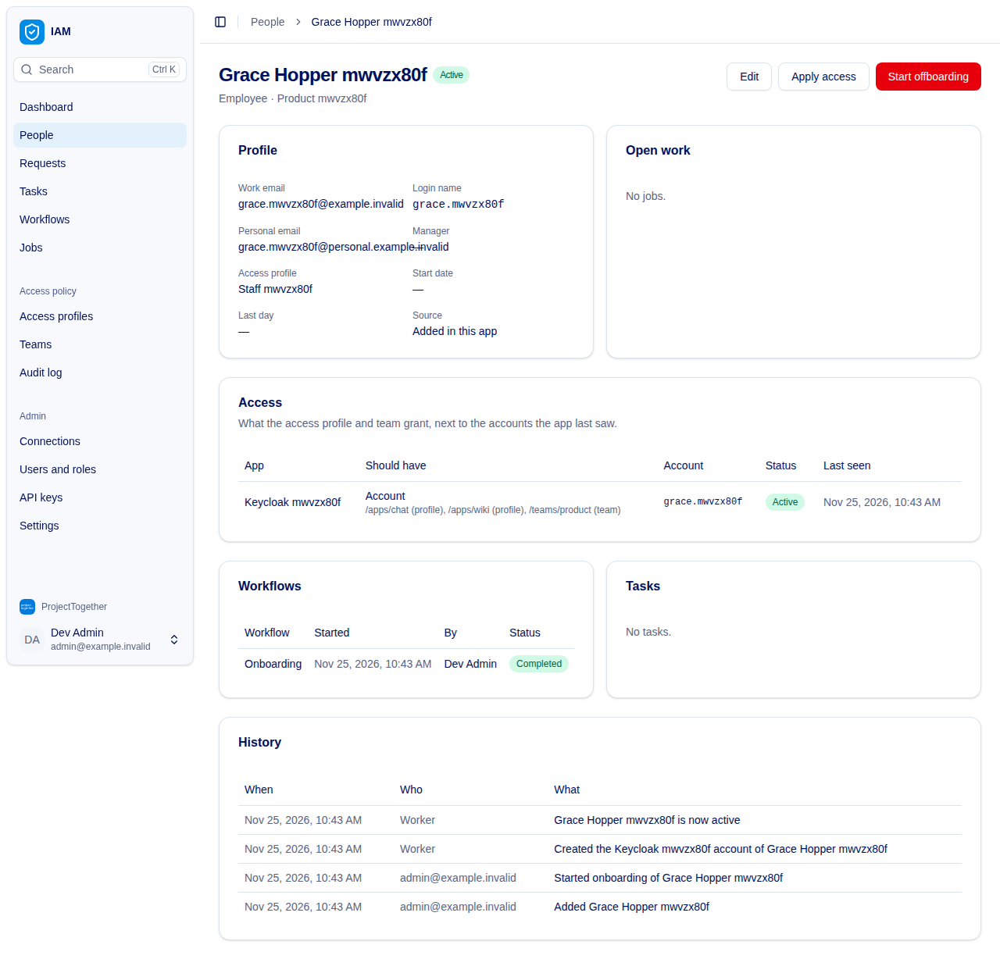

# IAM

ProjectTogether's open-source identity and access management app. One place
for the people who work with an organization, the access each of them should
have, and the onboarding and offboarding that follow from it, for
organizations that run their own tools.

- **People** with type, team, manager, access profile, start date and last day,
  added by hand or imported from Personio.
- **Access profiles** say which apps a kind of person gets an account in, and
  the groups there. **Teams** add their own groups.
- **Identity requests** from other apps, such as Helpdesk: they ask for a new
  person through an API with a key; an approver adds the person, links one
  who is already here, or rejects the request. Admins choose which person
  types other apps may request.
- **Workflows** carry out onboarding, access updates and offboarding. The worker
  makes each change in the connected app, retries what fails for a moment, and
  hands everything else to a person as a task.
- **Connections** to Keycloak, Google Workspace, any SCIM 2.0 app (such as
  Connector), HubSpot, Slack, Notion, Relution and apps without an API
  (manual tasks), plus Personio as a people source and SMTP for email. Admins
  add, test and configure every connection in the admin section, or an
  operator on the server with `cli settings`; credentials are stored
  encrypted.
- **Safety**: the app only adds and removes the groups its policy manages,
  automatic removals beyond a daily limit wait for an admin, offboarding
  never skips an app silently, account comparisons report drift without
  changing anything, and every change lands in the audit log.
- **Read-only mode** (`READ_ONLY=1`) for trying the app with real data: it
  reads every connected app but changes nothing in them and sends no email,
  and each job reports what it would have changed.
- **Sign-in** with any OpenID Connect provider or Keycloak. The app's own users
  and roles (viewer, approver, admin) decide what someone may do; roles can
  also come from the provider's group claim.
- **Deploys at any time:** a restart lets the running job and requests
  finish; a job cut short runs again, and nothing is done twice.

TypeScript on Node.js 26: a Hono server (`apps/server`, Drizzle ORM on
PostgreSQL) and a React web app (`apps/web`, Vite, TanStack Router and
Query). One Docker image with three processes: `migrate` (one-off), `web` and
`worker` (jobs and schedule; no Redis or queue needed).



## Documentation

- [Deployment](docs/deployment.md): a Linux server (Debian, Ubuntu),
  PostgreSQL, health checks, settings from the command line, read-only mode,
  upgrades, builds and deploys
- [Configuration](docs/configuration.md): every environment variable
- [Sign-in and roles](docs/authentication.md): OpenID Connect, Keycloak, roles, first admin
- [Connections](docs/connections.md): setting up each app
- [How it works](docs/architecture.md): desired access, workflows, jobs, tasks, sync, restarts
- [API for other apps](docs/api.md): identity requests with an API key
- [Glossary](CONTEXT.md)
- [Contributing](CONTRIBUTING.md): development setup, checks, end-to-end check

## Quick start (development)

```sh
docker compose -f compose.dev.yaml up -d   # PostgreSQL, Keycloak, Mailpit
cp .env.example .env
npm ci
npm run db:migrate
npm run dev                                # web app, API and worker: http://localhost:5173
```

Sign in with `admin` / `admin` (the development Keycloak's admin user, member
of `/iam/admins`). The development Keycloak also has a ready client for the
Keycloak connection: see [CONTRIBUTING.md](CONTRIBUTING.md).

## License

Copyright 2026 ProjectTogether gGmbH

Licensed under the [Apache License 2.0](LICENSE).
